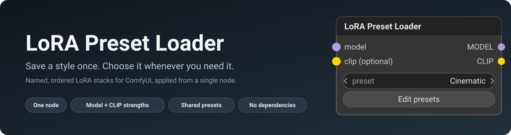
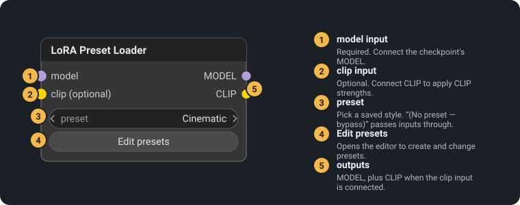
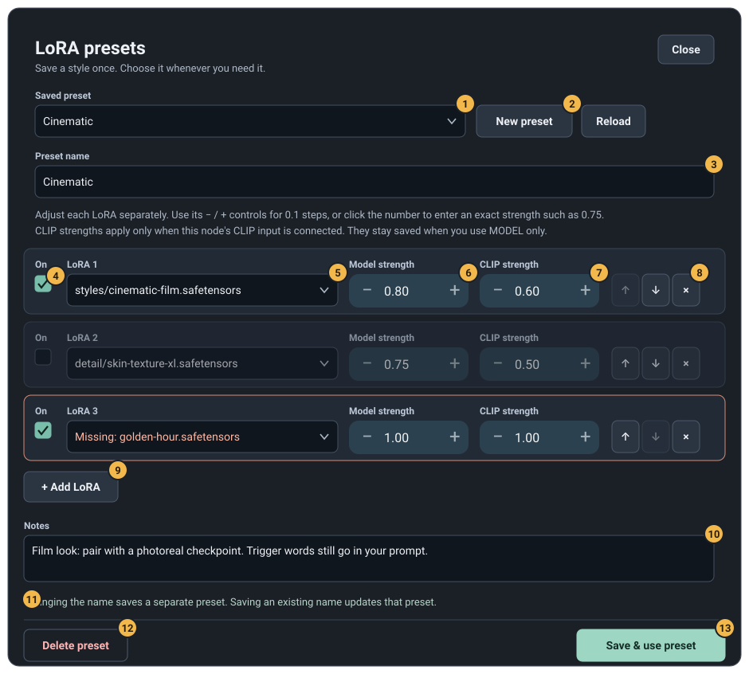
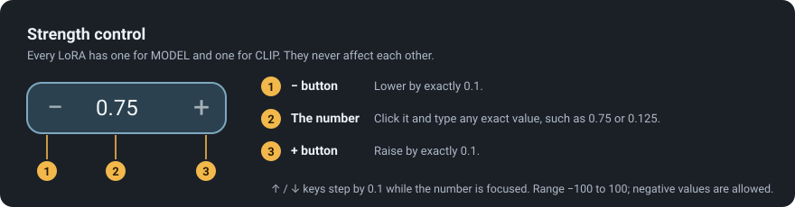
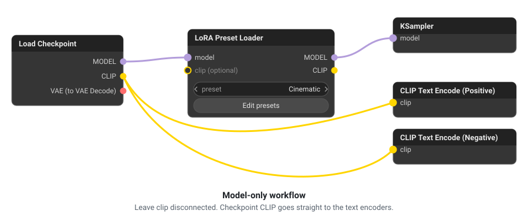
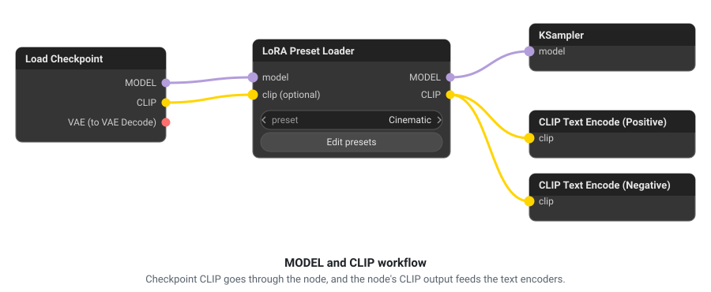

<p align="center">
  
</p>

<p align="center">
  <a href="https://github.com/Aerobit/ComfyUI-LoRA-Preset-Loader/releases/latest"></a>
  <a href="LICENSE"></a>
  
</p>

# LoRA Preset Loader for ComfyUI

Stop rebuilding the same chain of LoRA loader nodes for every workflow. Save a reusable, named stack of LoRAs once, such as **Ultra Realism**, **Cinematic** or **Anime**, then apply it from **one node** with a dropdown.

A preset remembers each LoRA file, its order, whether it is switched on, its **model strength**, its **CLIP strength**, and your notes.

> The images in this README are illustrations drawn from the real interface, not screenshots.

**Jump to:** [Features](#features) · [Install](#installation) · [Quick start](#quick-start) · [The editor](#the-preset-editor) · [Strengths](#strength-controls) · [Wiring](#connecting-model-and-clip) · [Behavior](#how-a-preset-runs) · [Storage](#where-presets-are-stored) · [Troubleshooting](#troubleshooting)

## Why use it

| Without this node | With this node |
| --- | --- |
| One loader node per LoRA, wired in a chain | One node, one dropdown |
| Strengths retyped or re-dragged in every workflow | Strengths saved with the preset |
| Switching style means rewiring or muting nodes | Switching style means choosing another name |
| Easy to forget which LoRAs belong to a look | Named presets with notes |

## Features

- **One node, any number of LoRAs.** No fixed slot limit. LoRAs are applied in the order shown. See [How a preset runs](#how-a-preset-runs).
- **Separate model and CLIP strengths** for every LoRA, with exact decimals such as `0.125`. See [Strength controls](#strength-controls).
- **Fine control.** Minus and plus buttons and the arrow keys step by `0.1`. Click the number to type any value from `-100` to `100`.
- **Optional CLIP.** Use MODEL alone, or connect CLIP to apply text-encoder weights too. See [Connecting MODEL and CLIP](#connecting-model-and-clip).
- **A built-in preset editor.** Create, update, delete, reorder, switch rows on or off, and keep notes. See [The preset editor](#the-preset-editor).
- **Presets shared across workflows** on the same ComfyUI installation, stored outside the extension so updates never remove them. See [Where presets are stored](#where-presets-are-stored).
- **Safe by default.** Missing LoRA files are reported before any LoRA is applied, and a missing preset never silently turns into bypass.
- **Bypass choice.** Pick **(No preset — bypass)** to pass MODEL and CLIP through unchanged.
- **Smart caching.** The node re-runs when the preset, its strengths, or a LoRA file changes.
- **No additional Python or JavaScript dependencies.** No LoRA files, checkpoints, or model weights are included.

## Installation

### Downloaded archive

1. Open the [latest release](https://github.com/Aerobit/ComfyUI-LoRA-Preset-Loader/releases/latest) and download the attached `comfyui-lora-preset-loader-*.zip` archive.
2. Extract the archive.
3. Copy the `comfyui-lora-preset-loader` folder into `ComfyUI/custom_nodes/`.
4. Confirm this file exists: `ComfyUI/custom_nodes/comfyui-lora-preset-loader/__init__.py`.
5. Restart ComfyUI completely.
6. Refresh the browser with `Ctrl+F5`.

For Windows portable, the usual location is `ComfyUI_windows_portable/ComfyUI/custom_nodes/`. Avoid an extra nested folder such as `comfyui-lora-preset-loader/comfyui-lora-preset-loader/`.

### Git clone

```sh
cd ComfyUI/custom_nodes
git clone https://github.com/Aerobit/ComfyUI-LoRA-Preset-Loader.git comfyui-lora-preset-loader
```

Restart ComfyUI after installing or updating.

## Quick start

<p align="center">
  
</p>

1. Double-click the ComfyUI canvas and add **LoRA Preset Loader**. It is under **model → loaders**.
2. Connect the checkpoint loader's **MODEL** output to the node's **model** input.
3. Click **Edit presets**.
4. Open the included **Ultra Realism** starter, or create a new preset.
5. Add your installed LoRAs and set each model and CLIP strength.
6. Click **Save & use preset**. The preset is now selected on the node.
7. Connect the node's **MODEL** output to your sampler, then queue as usual. Later, choose any saved preset from the node's dropdown.

The **Ultra Realism** starter is empty on purpose: the extension cannot know which LoRAs you have installed.

## The preset editor

Click **Edit presets** on the node to open the editor.

<p align="center">
  
</p>

| # | Part | What it does |
| --- | --- | --- |
| 1 | **Saved preset** | Switch to another saved preset, or choose *New preset…* for a blank one. |
| 2 | **New preset** and **Reload** | *New preset* starts blank. *Reload* refreshes the preset data and ComfyUI's list of installed LoRAs. |
| 3 | **Preset name** | Saving under the same name updates that preset. **Changing the name creates a separate preset.** Replacing a different existing name asks for confirmation. |
| 4 | **On** checkbox | Switch a LoRA off without deleting it. Disabled rows are dimmed and ignored when the preset runs. |
| 5 | **LoRA file** | Choose from the LoRAs ComfyUI can see. A file that is no longer installed is shown as `Missing: …` with an orange outline. |
| 6 | **Model strength** | How strongly this LoRA affects the model. |
| 7 | **CLIP strength** | How strongly it affects the text encoder. Only used when the node's CLIP input is connected. |
| 8 | **↑ ↓ ×** | Move a row up or down, or remove it. The order shown is the order in which LoRAs are applied. |
| 9 | **+ Add LoRA** | Add another row. It is unavailable until ComfyUI has at least one installed LoRA. |
| 10 | **Notes** | Free text for reminders such as the intended checkpoint or trigger words. Notes never change your prompt. |
| 11 | **Status line** | Shows hints, unsaved changes, saving progress and any error. |
| 12 | **Delete preset** | Removes the saved preset after confirmation. Workflows that still use it will report an error until you choose another. |
| 13 | **Save & use preset** | Saves the preset and selects it on the node that opened the editor. |

Good to know:

- **Unsaved changes are protected.** Closing the editor, switching presets, starting a new one or reloading asks before discarding your edits. `Esc` behaves like **Close**.
- **A row's `Missing:` outline appears for enabled rows only.** Saving is refused while an enabled row points to a file that is not installed, so fix it or switch the row off.
- **Notes are reminders only.** Trigger words still belong in your normal prompt nodes.
- Typing in the editor never triggers ComfyUI canvas shortcuts.

## Strength controls

<p align="center">
  
</p>

Every LoRA has an independent **Model strength** and **CLIP strength**:

- **−** and **+** adjust by exactly `0.1`, with no floating-point drift.
- The **↑** and **↓** keys do the same while the number is focused.
- Click the number to type an exact value. Values such as `0.75` and `0.125` are kept exactly.
- Accepted values range from `-100` to `100`, including negative values.
- Changing one field never changes another LoRA, or the other strength on the same LoRA.

## Connecting MODEL and CLIP

**MODEL is required. CLIP is optional.** Choose the layout that matches your workflow.

### Model-only workflow

<p align="center">
  
</p>

- Connect the checkpoint **MODEL** to the preset loader, and the loader's **MODEL** to the sampler.
- Leave both CLIP sockets on the preset loader disconnected.
- Keep the checkpoint **CLIP** connected directly to the text encoders.

Only each row's model strength is applied. Saved CLIP strengths stay stored for future use.

### Model and CLIP workflow

<p align="center">
  
</p>

| From | To |
| --- | --- |
| Checkpoint loader **MODEL** | LoRA Preset Loader **model** |
| Checkpoint loader **CLIP** | LoRA Preset Loader **clip** |
| LoRA Preset Loader **MODEL** | Sampler **model** |
| LoRA Preset Loader **CLIP** | Positive and negative text encoders' **clip** inputs |

The VAE connection does not pass through this node.

## How a preset runs

When you queue a prompt:

1. The node reads the selected preset.
2. **Disabled rows are dropped.** So are rows whose strengths are both zero when CLIP is connected, and rows whose model strength is zero when it is not.
3. **Every remaining LoRA file is checked first.** If any is missing, the node stops with a message naming the files, before the first LoRA is applied.
4. The LoRAs are applied **in the order shown in the editor**, using ComfyUI's own built-in `LoraLoader`.
5. The node returns the modified MODEL, and the modified CLIP when CLIP was connected.

Also:

- **Errors are caught early.** A preset with missing files, or no LoRAs yet, is reported when you queue rather than producing a quietly wrong image.
- **Bypass is explicit.** **(No preset — bypass)** returns MODEL and any connected CLIP unchanged. A preset name that no longer exists is an error, never a silent bypass.
- **Caching is reliable.** The result is reused only while the preset and the LoRA files (path, size and modified time) are unchanged.
- **Repeats are allowed.** Listing the same LoRA file twice applies it twice.

## Where presets are stored

Presets live outside the extension folder, so updating the code never removes them:

```text
ComfyUI/user/lora_preset_loader/presets.json
```

If ComfyUI uses a custom user directory, the same `lora_preset_loader/presets.json` subpath is used there.

- **Shared across workflows.** Workflows store the preset *name*, not its contents. Editing a preset affects future runs of every workflow that uses that name.
- **Safe writes.** Each save replaces the file atomically and keeps the previous version as `presets.json.bak`.
- **No lost edits.** If another tab changed the presets after you opened the editor, the save is rejected. Note what you need, click **Reload**, and apply the edit again.
- **Limits.** Names are 1–120 characters, notes up to 8,000, and the file up to 1 MiB.

The schema and manual-editing rules are in [docs/PRESET_FORMAT.md](docs/PRESET_FORMAT.md).

## Example presets

Ideas for getting started. The file names below are placeholders; use LoRAs you have installed.

| Preset | Example rows (file · model / CLIP) | Notes you might keep |
| --- | --- | --- |
| **Ultra Realism** | `detail/skin-texture.safetensors` · 0.75 / 0.50<br>`lighting/natural-light.safetensors` · 0.60 / 0.40 | Photoreal checkpoint, soft lighting |
| **Cinematic** | `styles/film-look.safetensors` · 0.80 / 0.60<br>`lighting/golden-hour.safetensors` · 0.50 / 0.30 | Wide aspect ratio, trigger word in prompt |
| **Anime** | `styles/anime-lineart.safetensors` · 0.90 / 0.70 | Use with an anime checkpoint |

## Troubleshooting

<details>
<summary>Common problems and fixes</summary>

| Problem | Resolution |
| --- | --- |
| Node does not appear | Check folder nesting, restart ComfyUI, press `Ctrl+F5`, and inspect the console for `IMPORT FAILED`. |
| No **Edit presets** button | Hard-refresh the browser and confirm the extension's `web` folder was copied. |
| LoRA is not listed | Add it to a configured LoRA folder, refresh ComfyUI's model list, then use **Reload**. |
| Missing LoRA error | Install the named file, choose the correct relative path, or disable/remove the row. |
| Presets changed since editor opened | Preserve any values you need, click **Reload**, and reapply the edit. |
| Cannot save | Confirm ComfyUI can write to its user directory; the error includes the attempted path. |
| Invalid preset file | Stop ComfyUI, correct `presets.json`, or restore `presets.json.bak`. |
| Old portable build lacks `get_user_directory` | Install the current release; it includes a fallback for older portable builds. |

</details>

Still stuck? See [SUPPORT.md](SUPPORT.md).

## Compatibility

The extension uses ComfyUI's supported V1 custom-node and JavaScript extension APIs. It delegates the actual LoRA application to ComfyUI's built-in `LoraLoader`, so LoRA format, checkpoint architecture and metadata compatibility match your installed ComfyUI version.

The project is tested without GPU inference, using ComfyUI substitutes. A real workflow in your installation remains the final compatibility check.

## Development

```sh
python -m unittest discover -s tests -v
node --check web/lora_presets.js
node --experimental-vm-modules tests/test_frontend.mjs
```

See [CONTRIBUTING.md](CONTRIBUTING.md) for the workflow and [docs/ARCHITECTURE.md](docs/ARCHITECTURE.md) for an implementation overview.

## Project documentation

- [Changelog](CHANGELOG.md)
- [Preset file format](docs/PRESET_FORMAT.md)
- [Architecture](docs/ARCHITECTURE.md)
- [Contributing](CONTRIBUTING.md) · [Security policy](SECURITY.md) · [Support](SUPPORT.md) · [Code of conduct](CODE_OF_CONDUCT.md)

## License

Released under the [MIT License](LICENSE).
